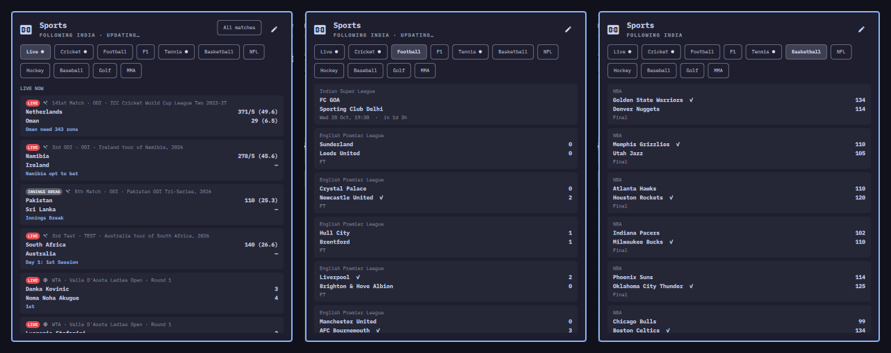

# Sports Hub

Every sport in one Omarchy bar widget. Live cricket with ball-by-ball alerts,
football, Formula 1, tennis, basketball, NFL, hockey, baseball, golf and MMA,
plus a **Live** tab that shows everything that is on right now.

Plugin id: `io.github.rajshimpi.sports-hub`



## What it does

- **Bar:** an icon, plus the live score of a followed team when one is
  playing. For cricket it shows the batting side, e.g. `IND 199/4`. Otherwise
  it shows a followed game or a live football match. Click it to open the panel.
- **Live tab:** live cricket, live games from every enabled sport and an F1
  race in progress, with the next six fixtures under *Coming up*. Your teams
  come first.
- **Cricket** (Cricbuzz): followed teams and internationals by default.
  **All matches** adds domestic, league and women's cricket.
- **Football, tennis, basketball, NFL, hockey, baseball, golf, MMA** (ESPN):
  live first, then upcoming, then results. Tennis shows singles set scores.
  Golf shows the top five, MMA the main card.
- **Formula 1** (Jolpica): next race with a countdown and qualifying time,
  last podium and the drivers' standings.
- Click any card to open the full scorecard, match page or leaderboard.

### Notifications

For the cricket teams in `follow`:

- toss and result
- every four, six and wicket, with batter, bowler and score
- batter 50s and 100s, bowler 3, 4 and 5-wicket hauls, 50 and 100 partnerships
- records that the commentators mention

For the teams and players in `followTeams`:

- football goals and full time
- start and final result in every other sport

Formula 1 sends a reminder 30 minutes before every race.

All alerts pause while a window title shows that you are in a meeting
(Teams, Zoom, Google Meet, Slack huddles, screen sharing).

## Install

```bash
omarchy plugin add https://github.com/RajShimpi/omarchy-sports-hub
omarchy bar put io.github.rajshimpi.sports-hub
```

You can also use **Install plugin** in the Omarchy menu with the repository URL.

## Remove

```bash
omarchy plugin remove io.github.rajshimpi.sports-hub
```

To clear what it left behind (cached scores and your settings):

```bash
rm -rf ~/.cache/omarchy/sports-hub ~/.config/omarchy/sports-hub.json
```

## Settings

Click the pencil in the panel. The first time, this creates
`~/.config/omarchy/sports-hub.json` with the defaults and opens it in your
editor. The plugin never writes that file otherwise. Missing keys use these
defaults:

```json
{
  "tabs": ["live", "cricket", "football", "f1", "tennis", "basketball", "nfl", "hockey", "baseball", "golf", "mma"],
  "follow": ["India"],
  "followTeams": [],
  "football": ["eng.1", "uefa.champions", "esp.1", "ind.1"],
  "leagues": {
    "basketball": ["nba"], "nfl": ["nfl"], "hockey": ["nhl"], "baseball": ["mlb"],
    "tennis": ["atp", "wta"], "golf": ["pga"], "mma": ["ufc"]
  },
  "f1": true,
  "notify": true,
  "ballAlerts": true,
  "quietWhenBusy": true,
  "companion": ""
}
```

| Key | Meaning |
| --- | --- |
| `tabs` | Tabs to show, in order. Remove a sport to hide it; its data is no longer fetched. |
| `follow` | Cricket teams, by name or short name (`"India"`, `"AUS"`). |
| `followTeams` | Teams or players in the other sports, e.g. `"Liverpool"`, `"Lakers"`, `"Carlos Alcaraz"`. |
| `football` | ESPN league codes: `eng.1` Premier League, `esp.1` LaLiga, `ger.1` Bundesliga, `ita.1` Serie A, `fra.1` Ligue 1, `ind.1` ISL, `usa.1` MLS, `uefa.champions`, `uefa.europa`, `fifa.world` and others. |
| `leagues` | ESPN league codes for the other sports, e.g. add `"wnba"` to basketball. |
| `f1` | Show Formula 1. |
| `notify` | Send notifications at all. |
| `ballAlerts` | Ball-by-ball cricket alerts (fours, sixes, wickets, milestones). |
| `quietWhenBusy` | Hold alerts while you are in a meeting. |
| `companion` | Optional: the IPC target of another shell plugin. On a four or six it gets `celebrate "<text>"`, and on a wicket `sad "<text>"`. For example, a desktop pet. |

### Keyboard

When the panel is open:

- `h` / `l` or Left / Right switch tabs
- `j` / `k` scroll
- `r` refreshes now
- `Esc` closes the panel

## How it works and dependencies

- `scripts/cricket` and `scripts/sports` are Python 3 scripts that use only
  the standard library, so nothing extra needs installing. They also use
  `omarchy-notification-send`, `hyprctl` and `xdg-open`, which Omarchy
  already provides.
- Scores come from public, unofficial endpoints that need no account or key:
  - the Cricbuzz live-scores page, plus its commentary and scorecard feeds
    for followed live matches
  - ESPN's `site.api.espn.com` scoreboards
  - the Jolpica F1 API (the Ergast successor)

  The sites may change these without notice, which would break that sport
  until the plugin is updated. The scripts only make plain GET requests and
  send nothing about you.
- Results are cached in `~/.cache/omarchy/sports-hub/`. With two monitors
  there are two bars. They share the cache and take turns through a file
  lock, so each alert arrives once.
- Refresh rate:
  - cricket every 30 s while a followed match is live, else every 2 or 15 min
  - other sports every minute while a followed game is live, every 3 min
    while anything else is, else every 10 min

## License

MIT. See [LICENSE](LICENSE). Not affiliated with Cricbuzz, ESPN or Jolpica.
